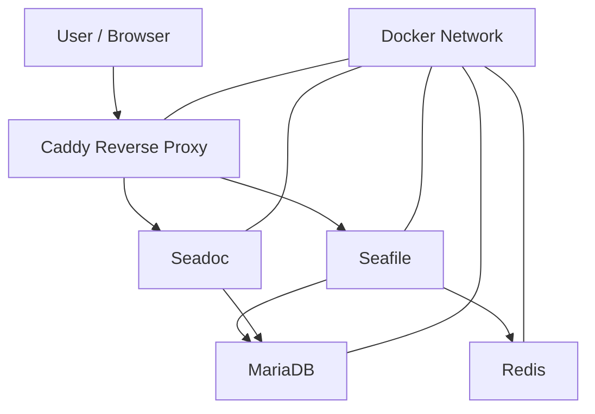

# Seafile — Self-Hosted File Collaboration Platform

A self-hosted file storage and collaboration platform deployed using Docker Compose, Caddy reverse proxy, MariaDB and Redis.

This project demonstrates containerized infrastructure deployment, reverse proxy integration, service networking, persistent storage, infrastructure troubleshooting and service management.

## Overview

The deployment provides a self-hosted file collaboration environment using containerized services with a reverse proxy for web access.

### Features

- Self-hosted cloud file storage
- Web-based file access and collaboration
- Docker container-based deployment
- Reverse proxy integration with Caddy
- HTTPS support
- MariaDB database integration
- Redis caching
- Seadoc collaborative document service
- Persistent container storage
- Container health checks and service dependencies

## Architecture



## Technology Stack

| Technology | Purpose |
|---|---|
| Docker | Containerization |
| Docker Compose | Service orchestration |
| Caddy | Reverse proxy and HTTPS |
| Seafile | File collaboration platform |
| Seadoc | Collaborative document service |
| MariaDB | Database |
| Redis | Caching |
| Docker Networking | Inter-container communication |

## Repository Structure

```text
Seafile-Self-Hosted/
├── README.md
├── seafile-server.yml
├── caddy.yml
├── seadoc.yml
└── docs/
    ├── architecture.md
    └── troubleshooting.md
```

## Infrastructure Components

### Caddy Reverse Proxy
- Handles HTTP/HTTPS traffic.
- Provides reverse proxy functionality.
- Dynamically discovers Docker services using Docker labels.
- Routes application and document-service requests.

### Seafile Application
- Provides self-hosted file storage and collaboration.
- Integrates with database and caching services.

### Seadoc
- Provides collaborative document editing functionality.
- Integrates with Seafile and the database.

### MariaDB
- Provides relational database services for the deployment.

### Redis
- Provides caching infrastructure.

### Docker Network
- Enables communication between containerized services through a dedicated network.

## Deployment Configuration

The repository contains example deployment configuration files:

- `seafile-server.yml` — Seafile, MariaDB and Redis configuration.
- `caddy.yml` — Caddy reverse proxy configuration.
- `seadoc.yml` — Seadoc configuration.

> These configuration files are sanitized portfolio examples. They are not intended to be copied directly into a production deployment without reviewing environment variables, secrets, storage paths, networking and service compatibility.

## Documentation

- [Architecture Documentation](docs/architecture.md)
- [Troubleshooting Documentation](docs/troubleshooting.md)

## Security Considerations

- Environment-based configuration for sensitive values.
- HTTPS reverse proxy integration.
- Redis password authentication.
- Dedicated Docker networking.
- Persistent data volumes.
- Docker socket access is used for dynamic proxy discovery and presents a privileged security risk.

Production deployments should use secure secret management, restrict host access, maintain container images, review Docker socket access and validate firewall and network exposure.

## Skills Demonstrated

- Docker and Docker Compose
- Containerized infrastructure deployment
- Reverse proxy configuration
- HTTPS integration
- Docker networking
- Database infrastructure
- Redis integration
- Infrastructure troubleshooting
- Service health monitoring
- Configuration management
- Security awareness

## Project

**GitHub Repository:**  
https://github.com/abhijith4m/Seafile-Self-Hosted

---

Developed as a hands-on infrastructure and DevOps portfolio project.
