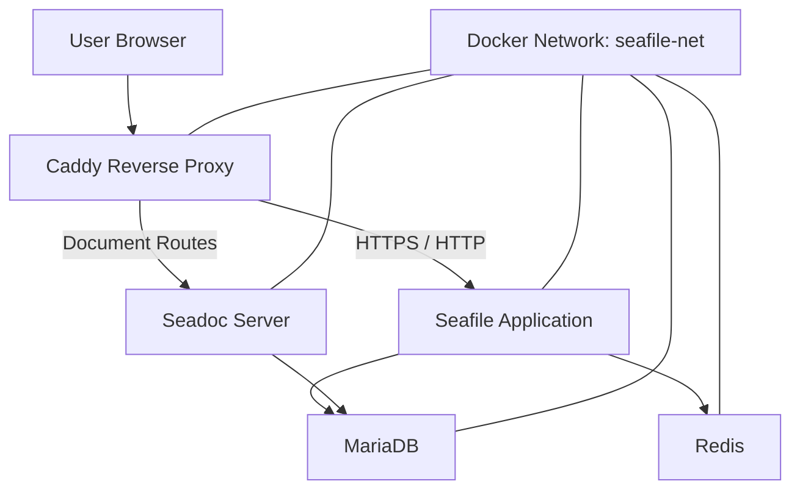

# Seafile Self-Hosted Architecture

## Overview

This project deploys a self-hosted Seafile file collaboration platform using Docker containers, reverse proxy infrastructure, database services and caching.

## Architecture

## Components

### Caddy
- Reverse proxy entry point.
- Handles HTTP and HTTPS traffic.
- Dynamically discovers Docker services using Docker labels.
- Routes traffic to the appropriate application services.

### Seafile
- File storage and collaboration application.
- Provides web-based file access and file synchronization.
- Integrates with MariaDB and Redis.

### Seadoc
- Collaborative document editing service.
- Integrated with the Seafile deployment.
- Routes document-related requests through Caddy.

### MariaDB
- Persistent relational database.
- Stores application-related database information.

### Redis
- Cache service used by the application.

### Docker Networking
- Services communicate through the shared Docker network `seafile-net`.

## Infrastructure Flow

1. Users access the platform through the configured domain.
2. Caddy receives incoming HTTP/HTTPS requests.
3. Caddy routes requests to the relevant container.
4. Seafile communicates with MariaDB and Redis.
5. Seadoc handles collaborative document functionality.
6. Persistent Docker volumes maintain application and database data.

## Deployment Technologies

- Docker
- Docker Compose
- Caddy Docker Proxy
- Seafile
- Seadoc
- MariaDB
- Redis

## Security Considerations

- Secrets are managed through environment variables.
- HTTPS is provided through the reverse proxy.
- Redis is configured with password authentication.
- Docker services are isolated using a dedicated network.
- Docker socket access is required for dynamic Caddy service discovery and should be treated as a privileged access risk.

